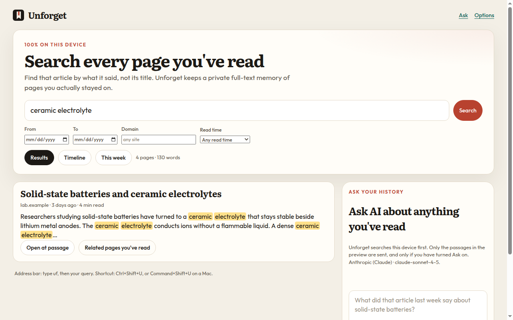
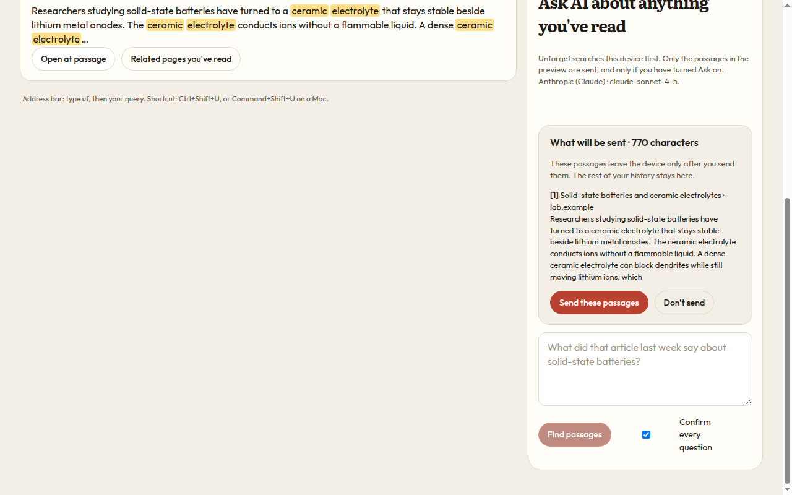

# Unforget

**Unforget: Search Every Page You've Read**

Find that article you read last week by what it said, not its title. Full-text search of your browsing, 100% local.

Chrome history remembers titles and URLs. Unforget remembers the words. After you stay on a page for a few seconds, it keeps the readable text on this device and lets you search it later. Nothing is sent anywhere unless you turn on Ask and confirm the passages.

## What you can do

- Search the text of pages you actually read, from the toolbar, the full search page, or the address bar (`uf your words`).
- Filter by date, site, and how long you spent reading. Switch to a timeline, or open **This week** for a local digest.
- Open a result on the matching passage. Chrome scrolls to the quoted text and Unforget highlights it.
- Skip incognito, `chrome://` pages, banking, health-portal, and webmail domains, pages with a password field, and any site on your blocklist. Pause capture whenever you want.
- Export JSON or Markdown, import a previous export, forget the last hour, or forget a whole site.
- **Ask your history** (off by default). Unforget searches locally first, shows you exactly which passages would be sent, and only then calls a model you choose: Anthropic, OpenAI, Gemini, OpenRouter, or a local OpenAI-compatible server such as Ollama or LM Studio. Answers cite the pages.
- Optionally connect a desktop agent. A small native-messaging host writes `~/.unforget/index.json`. [`unforget-mcp`](mcp/README.md) exposes read-only `search_history` and `get_page` tools to Claude Desktop, Claude Code, Cursor, Google Antigravity, and any other MCP client.

With Ask left off, the extension makes no network requests.





## Install from source

You need Node 20 or newer.

```bash
npm install
npm test
npm run build
```

In Chrome, open `chrome://extensions`, turn on Developer mode, choose **Load unpacked**, and select the `dist/` folder.

Package a store zip with:

```bash
npm run zip
```

That writes `unforget-<version>.zip` with `manifest.json` at the root of the archive.

The unpacked extension id is stable (`bikdfibehenngminabomcdhmhmjdiaaj`) because the manifest carries a public key. The desktop bridge allowlists that id. See [bridge/README.md](bridge/README.md).

## Privacy

Pages you read stay in IndexedDB on this computer. Settings and, if you add one, your API key stay in `chrome.storage.local`. Keys are never put in `chrome.storage.sync`. You can encrypt the key with a passphrase; the passphrase itself is not stored.

Unforget does not ship a server, an account, or analytics. Host permission for an AI provider is requested only when you enable that provider, and only for that origin. Local embeddings are a hashed bag-of-words computed on device. There is no model download.

Read [PRIVACY.md](PRIVACY.md) before you publish or install it. The store copy is in [STORE_LISTING.md](STORE_LISTING.md).

## How the index stays fast

Each page is tokenized, lightly stemmed, and stored as postings in IndexedDB (term, document, count, a few character offsets). A query loads only the postings for its terms, scores them with BM25, then blends in a 128-dimension on-device hash embedding so near-duplicate wording ranks nearby. Snippets are windows around the match offsets, with the words highlighted. Ten thousand pages do not have to sit in the service-worker heap.

## Project layout

| Path | What it is |
| --- | --- |
| `src/` | Extension: background worker, content script, search, popup, options, side panel |
| `shared/` | Tokenizer, BM25, snippets, and local embeddings, shared with the MCP server |
| `mcp/` | `unforget-mcp`, a read-only stdio MCP server |
| `bridge/` | Native messaging host that writes the local index file |
| `tests/unit` | Vitest: extraction, ranking, retention, prompts, providers |
| `tests/e2e` | Playwright loads the built extension and finds a local page by its text |

```bash
npm run lint
npm run typecheck
npm test
npm run test:e2e
```

## Desktop agents

One-time, after you enable **Desktop bridge** in Options:

```bash
node bridge/install.mjs
npm run build -w unforget-mcp
```

Config snippets for Claude Desktop, Claude Code, Cursor, and Antigravity are in [mcp/README.md](mcp/README.md). The tools can search and read. They cannot delete. Revoke access by turning the bridge off and removing the native-messaging manifest.

## Third-party notices

`@mozilla/readability` is Apache-2.0. Literata and Outfit are SIL Open Font License 1.1. See [NOTICE](NOTICE).

## License

MIT. See [LICENSE](LICENSE).
