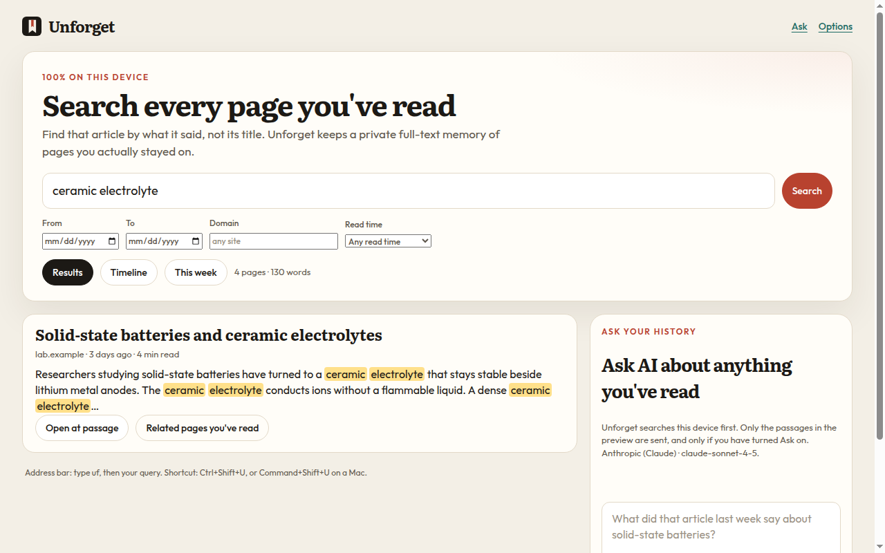
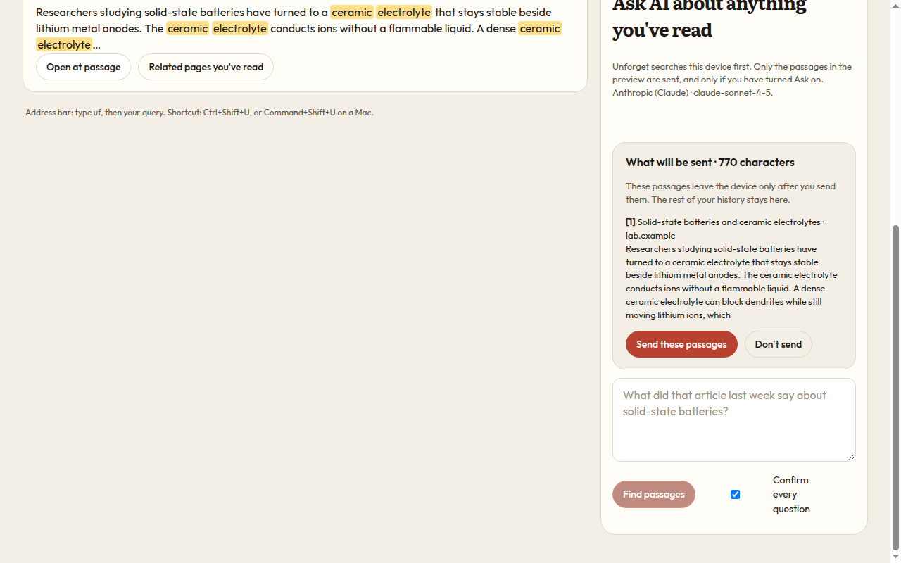
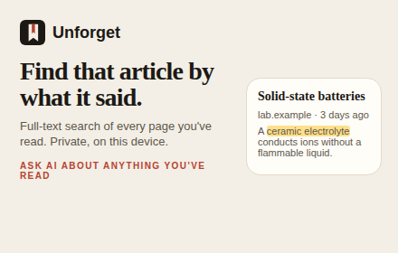

# Chrome Web Store listing

## Name

Unforget: Search Every Page You've Read

## Short description

Find that article you read last week by what it said, not its title. Full-text search of your browsing, 100% local.

(115 characters. The limit is 132.)

## Full description

Find that article by what it said, not its title.

Unforget is a private, on-device memory of the pages you actually read. Stay on an article for a few seconds and the readable text is indexed locally. Later you can search "that piece about ceramic electrolytes" and open it on the matching passage.

Search from the toolbar, the full search page, or the address bar with the keyword `uf`. Filter by date, site, and reading time. Browse a timeline or a weekly digest of what you read.

It skips incognito, browser-internal pages, banking, health-portal, and webmail domains, any page with a password field, and domains you block. You can pause it, forget the last hour, or forget a whole site. Export JSON or Markdown, or import an export, without an account.

Ask AI about anything you've read. This is off by default and uses a key you bring yourself: Anthropic Claude, OpenAI ChatGPT, Google Gemini, OpenRouter, or a local model through Ollama, LM Studio, or any OpenAI-compatible URL. Unforget searches your index first, shows you the exact passages that would leave the device, and sends only those. Answers link back to the page and the passage. Nothing is sent until Ask is on, and the first send waits for you.

A desktop agent can use the same memory. An optional local bridge writes an index file, and the read-only `unforget-mcp` server lets Claude Desktop, Claude Code, Cursor, or Google Antigravity call `search_history` and `get_page`. It cannot delete anything, and you can turn it off.

No account. No analytics. With Ask and the desktop bridge left off, Unforget does not use the network.

## Category

Productivity

## Single-purpose statement

Unforget's single purpose is to help you find, and optionally ask questions about, the text of pages you have read, using an index that stays on your device.

## Permission justifications

| Permission | Why it is needed |
| --- | --- |
| `storage` | Save your settings on this device. The optional API key is stored here too, in `chrome.storage.local`, never in sync storage. |
| `unlimitedStorage` | A full-text index of many pages can grow past the default extension quota. The index is local. |
| `alarms` | Run retention cleanup, and refresh the on-device weekly reading digest. |
| `activeTab` | When you click the toolbar icon, read the current tab's URL so "Forget this site" and "Summarize this page" apply to the page you are looking at. |
| `sidePanel` | Open the Ask panel beside the page you are reading. |
| `contextMenus` | Right-click to save a page now, forget that page, or search Unforget for the selected words. |
| `nativeMessaging` (optional) | Only if you enable the desktop bridge. Lets the extension talk to the local host that writes `~/.unforget/index.json` for MCP clients. Not granted at install. |
| Host access (optional, requested at runtime) | Only after you choose a provider. Anthropic, OpenAI, Gemini, and OpenRouter each request their own API host. A custom Ollama, LM Studio, or other OpenAI-compatible endpoint requests only the origin you typed. `http://*/*` and `https://*/*` are optional patterns so that one origin can be granted. They are not granted at install, and the extension does not request them until you enable that endpoint. |

Content scripts are limited to `http://*/*` and `https://*/*` so a normal page can be read after you dwell on it. They are not granted for `chrome://` pages, and the extension is not allowed in incognito.

The omnibox keyword `uf` does not require a permission.

## Data-usage disclosure

Answer these as follows in the developer dashboard.

**Does this item collect or use user data?**

The developer does not collect user data. The extension processes website content locally so you can search it. No data is transmitted to the developer.

**Data types handled on the device**

- **Website content.** The readable text of pages you dwell on, stored in IndexedDB, so you can search it.
- **Web history.** URLs and the time you read them, stored with that text.
- **Authentication information.** Only if you turn Ask on and paste an API key. The key is stored in `chrome.storage.local` (optionally encrypted) and is sent only to the provider you select.

**Certifications**

- I do not sell or transfer user data to third parties, except that when the user enables Ask and confirms a question, the passages shown in the preview are sent to the AI provider the user chose. They are not sent to Unforget.
- I do not use or transfer user data for purposes unrelated to the item's single purpose.
- I do not use or transfer user data to determine creditworthiness or for lending purposes.

**Is data encrypted in transit?**

Local data is not transmitted. When the user enables Ask, requests go to the provider over HTTPS (or to a local endpoint the user configured, which may be plain HTTP on localhost).

**Privacy policy**

Use the URL of `PRIVACY.md` on the public repository once the project is published. The policy text is that file.

## Assets

- Icons: `public/icons/16.png`, `32.png`, `48.png`, `128.png`
- Screenshots (1280×800): `docs/search.png`, `docs/ask.png`, `docs/options.png`
- Promo tile (440×280): `docs/promo-440x280.png`

